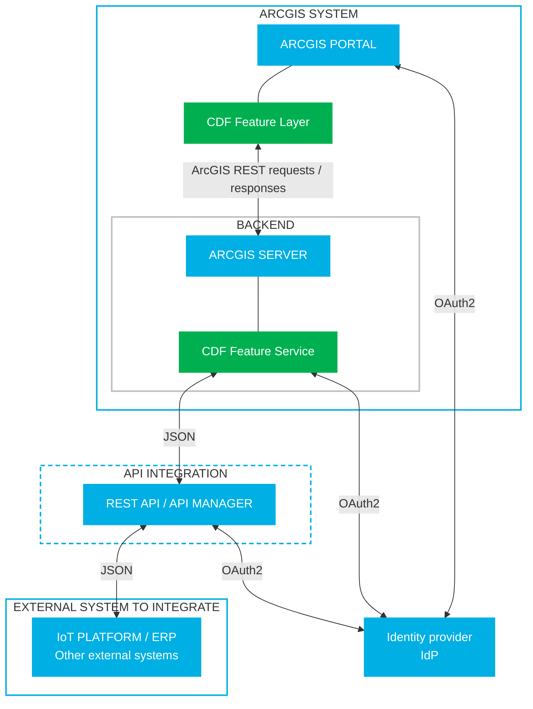

# ArcGIS Custom Data Feeds

Examples and experiments for connecting external data sources to ArcGIS Enterprise through **Custom Data Feeds (CDF)**. This repository explores providers for Databricks, DuckDB and Parquet, and FIWARE, alongside tools for configuring and publishing services.

## What are Custom Data Feeds?

Custom Data Feeds let ArcGIS expose data from sources it does not natively support as **feature services**. A custom data provider, written in JavaScript and running in Node.js, connects to the source and translates its data into a form ArcGIS can serve. Clients access the resulting FeatureServer endpoint to display and query features. See Esri's [CDF overview](https://developers.arcgis.com/enterprise-sdk/guide/custom-data-feeds/).

The provider is the integration code; the feature service is the interface used by maps and applications. One registered provider can support multiple services with different configurations.

## What are they meant for?

CDF is useful when data lives in an external API, a proprietary format, a remote platform, or a third-party system that needs to remain the source of truth. It provides a way to make that data available to ArcGIS clients without first maintaining a separate hosted copy of the dataset.

Typical uses include:

- Showing business or sensor data from a REST API on a map.
- Querying spatial records held in an external analytics platform.
- Adapting files or custom storage formats into features with geometry and attributes.
- Providing several feature services through a reusable connector.

The provider must implement source access and data conversion. Query performance, freshness, and supported operations depend on that implementation and the source system. Esri's [architecture guidance](https://architecture.arcgis.com/en/framework/architecture-pillars/integration/methods/custom-data-feeds.html) explains where CDF fits among integration approaches.

## Architecture

This integration pattern connects an ArcGIS Portal feature layer to an external system through a CDF feature service and a REST API or API manager. An identity provider (IdP) supports OAuth2 authentication for the participating components.

The CDF provider adapts the external API's JSON into features for ArcGIS Server. Portal references the resulting feature service through a feature layer. The IdP connections represent authentication relationships; the exact OAuth2 flow depends on the deployment.

## Projects in this repository

| Project | Purpose |
| --- | --- |
| [Databricks provider](databricks-provider/README.md) | Connects feature services to Databricks SQL for analytical queries and Lakebase for editable data. |
| [Databricks builder](databricks-builder/README.md) | Companion app for browsing metadata, configuring spatial fields, and publishing services using a separately deployed provider. |
| [DuckDB binning](duckdb-binning/README.md) | Queries Parquet taxi points with DuckDB; the current example does not implement bin aggregation. |
| [DuckDB points](duckdb-points-cu2025/README.md) | Point-data example using taxi trip data. |
| [DuckDB honeycombs](duckdb-honeycombs-cu2025/README.md) | Hexagonal aggregation example for taxi trip data. |
| [DuckDB origin-destination](duckdb-od-cu2025/README.md) | Origin-destination example for taxi trips. |
| [FIWARE](fiware-app/README.md) and [dynamic FIWARE](fiware-app-dynamic/README.md) | Provider experiments that fetch entities from an Orion context broker API. |

## Background and credits

**All custom code developed for this repository was created through vibe coding with OpenAI Codex.** I define the goals, guide architecture and integration choices, and steer implementation through prompts, feedback, and iteration; Codex generates the code.
