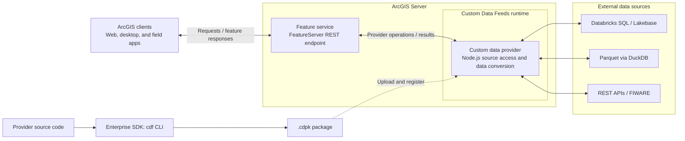

# ArcGIS Custom Data Feeds

Examples and experiments for connecting external data sources to ArcGIS Enterprise through **Custom Data Feeds (CDF)**. This repository explores providers for Databricks, DuckDB and Parquet, and FIWARE, alongside tools for configuring and publishing services.

## What are Custom Data Feeds?

Custom Data Feeds let ArcGIS expose data from sources it does not natively support as **feature services**. A custom data provider, written in JavaScript and running in Node.js, connects to the source and translates its data into a form ArcGIS can serve. Clients access the resulting FeatureServer endpoint to display and query features. See Esri's [CDF overview](https://developers.arcgis.com/enterprise-sdk/guide/custom-data-feeds/).

The provider is the integration code; the feature service is the interface used by maps and applications. One registered provider can support multiple services with different configurations.

## What are they meant for?

CDF is useful when data lives in an external API, a proprietary format, a remote platform, or a third-party system that needs to remain the source of truth. It provides a way to make that data available to ArcGIS clients without first maintaining a separate hosted copy of the dataset.

Typical uses include:

- Showing business or sensor data from a REST API on a map.
- Querying spatial records held in an external analytics platform.
- Adapting files or custom storage formats into features with geometry and attributes.
- Providing several feature services through a reusable connector.

The provider must implement source access and data conversion. Query performance, freshness, and supported operations depend on that implementation and the source system. Esri's [architecture guidance](https://architecture.arcgis.com/en/framework/architecture-pillars/integration/methods/custom-data-feeds.html) explains where CDF fits among integration approaches.

## Architecture

The diagram separates the deployed request path from the development and packaging workflow. It shows a general CDF architecture; each example implements its own source connection.

Feature services are read-only by default. Editing requires a provider that implements it and an appropriately configured service on a supporting ArcGIS Enterprise version. The Databricks example includes a Lakebase editing path; capabilities differ across projects.

## Projects in this repository

| Project | Purpose |
| --- | --- |
| [Databricks provider](databricks-provider/README.md) | Connects feature services to Databricks SQL for analytical queries and Lakebase for editable data. |
| [Databricks builder](databricks-builder/README.md) | Companion app for browsing metadata, configuring spatial fields, and publishing services using a separately deployed provider. |
| [DuckDB binning](duckdb-binning/) | Explores spatial binning over Parquet data using DuckDB. |
| [DuckDB points](duckdb-points-cu2025/) | Point-data example using taxi trip data. |
| [DuckDB honeycombs](duckdb-honeycombs-cu2025/) | Hexagonal aggregation example for taxi trip data. |
| [DuckDB origin-destination](duckdb-od-cu2025/) | Origin-destination example for taxi trips. |
| [FIWARE](fiware-app/) and [dynamic FIWARE](fiware-app-dynamic/) | Provider experiments that fetch entities from an Orion context broker API. |
| [Open Location Codes scaffold](openlocationcodes/) | Starter provider structure; its current model returns an empty feature collection. |

These are separate examples with different ArcGIS version targets, rather than one application to install from the repository root. Check each project's `cdconfig.json`, configuration, and documentation before running it.

## Development and deployment

1. Choose an example and identify its target ArcGIS Enterprise version.
2. Set up a compatible Node.js environment and the Enterprise SDK's CDF CLI. Follow Esri's [installation and configuration guide](https://developers.arcgis.com/enterprise-sdk/guide/custom-data-feeds/installing-and-configuring-custom-data-feeds/) for development and server runtime requirements.
3. Configure your source connection and implement or adapt the provider. Keep credentials in local environment variables or untracked configuration. See [Create a Custom Data Feed Provider](https://developers.arcgis.com/enterprise-sdk/guide/custom-data-feeds/create-a-custom-data-feed-provider/).
4. Test locally, then package the provider as a `.cdpk` with the CDF CLI. Inspect the package before sharing it to ensure it contains no credentials or private datasets.
5. [Register the provider with ArcGIS Server](https://developers.arcgis.com/enterprise-sdk/guide/custom-data-feeds/register-a-custom-data-provider/) and create a feature service that references it.

Use the documentation for your deployed version. Checked-in packages are snapshots and do not automatically reflect later source changes.

## Background and credits

**All custom code developed for this repository was created through vibe coding with OpenAI Codex.** I define the goals, guide architecture and integration choices, and steer implementation through prompts, feedback, and iteration; Codex generates the code.
