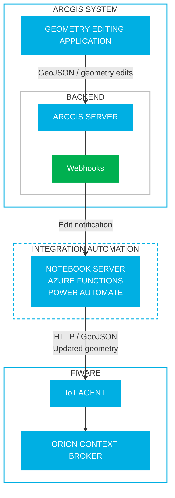

# FIWARE sensor provider

Fetches entities from an Orion Context Broker's `/v2/entities` REST endpoint and exposes their locations as GeoJSON points through a CDF feature service. This variant explicitly maps name, humidity, and temperature fields. The manifests target **ArcGIS 11.1.0** and register the provider as `fiware`.

## Request flow

The local server registers the provider with the bundled Koop/CDF framework. `getData(req, callback)` performs a GET request with `node-fetch`, checks the HTTP status, reads the JSON entity array, and builds a `FeatureCollection`. The framework serves the collection through its FeatureServer output.

The model maps a fixed sensor schema into feature properties:

| Input | Output |
| --- | --- |
| `id` | `id` |
| `name.value` | `name` |
| `humidity.value.percentage` | `humidity` |
| `temperature.value.degreeCentigrade` | `temperature` |
| `location.value.coordinates` | Point geometry coordinates |

All these input paths are accessed directly. An entity missing one of the nested sensor fields can fail the entire request.

Both variants require `location.value.coordinates` and always emit `Point` geometry. The metadata names the layer `Integracion con FIWARE` and uses `id` as its identifier.

## Configuration

The source URL is hardcoded in [model.js](providers/fiware-provider/src/model.js). Replace it with your broker's endpoint. There is currently no environment-variable override, OAuth flow, API-key header, tenant header, or broker pagination implementation in the model. The request fetches only the entities returned by that single endpoint call; ArcGIS query parameters are not forwarded to Orion.

Set the local port in [config/default.json](config/default.json); the default is `8080`. The provider's [configuration](providers/fiware-provider/config/default.json) is empty. Startup merges provider configuration into the application configuration.

## Run locally

Install dependencies from this project folder. The application, provider, and framework folders are separate npm packages:

```powershell
npm install
npm install --prefix providers/fiware-provider
Get-ChildItem framework -Directory | ForEach-Object {
    if (Test-Path (Join-Path $_.FullName 'package.json')) {
        npm install --prefix $_.FullName
    }
}
```

```powershell
npm start
```

The route configuration disables both host and source-ID parameters. The local layer URL is:

```text
http://127.0.0.1:8080/fiware/rest/services/FeatureServer/0
```

Use `/query?where=1%3D1&outFields=*&f=json` to request features. Both FIWARE examples default to port 8080, so choose different configured ports if running them together. No frontend is included in this project.

## Code map

| Path | Responsibility |
| --- | --- |
| [Provider model](providers/fiware-provider/src/model.js) | Broker request, entity mapping, and error propagation. |
| [Provider entry point](providers/fiware-provider/src/index.js) | Registers the model and manifest options. |
| [Provider manifest](providers/fiware-provider/cdconfig.json) | Service name and route configuration. |
| [src/index.js](src/index.js) and [src/plugins.js](src/plugins.js) | Local server and provider loading. |
| [framework/](framework/) | Bundled Koop, cache, and FeatureServer output. |

The application manifest retains the scaffold name `prueba-rest`; service routing uses `fiware` from the provider manifest. The `.cdpk` file is a packaged snapshot and is not updated when source files change.

## Current limits and validation

The model disables TLS certificate verification process-wide using `NODE_TLS_REJECT_UNAUTHORIZED=0` and logs the complete broker response. Restore certificate verification and remove payload logging before connecting a real private feed.

There is no provider test directory or application test directory, despite the `npm test` scripts in the manifests. Validate with a controlled broker response and check geometry, attributes, identifiers, and pagination needs. No broker was contacted during this documentation review.

See the [dynamic variant](../fiware-app-dynamic/README.md) for the alternative mapping.

## Development approach

All custom adaptations and additions in this project were created through **vibe coding with OpenAI Codex**, guided through prompts, feedback, and iteration. Upstream code, bundled frameworks, generated scaffolding, and dependencies retain their original authorship and licenses. See the [repository overview](../README.md).

## TO DO: Update FIWARE data from ArcGIS

**Status: proposed workflow — not implemented in this project.**

The current provider reads data from FIWARE into ArcGIS. The following figure, recreated from the proposed architecture, shows the **reverse direction: moving updated geometry from ArcGIS to FIWARE**.



The intended flow is for a geometry edit in ArcGIS to trigger a webhook, then for an automation component to obtain the updated geometry and send it to FIWARE through an IoT Agent, updating the corresponding entity in Orion Context Broker. Notebook Server, Azure Functions, and Power Automate represent alternative automation options.

- [ ] Configure edit notifications for the ArcGIS feature service.
- [ ] Implement the webhook handler and retrieval of the edited geometry.
- [ ] Define the mapping between ArcGIS feature IDs and FIWARE entity IDs.
- [ ] Validate the chosen IoT Agent's HTTP payload contract and convert geometry into its required format.
- [ ] Implement authenticated updates, retry handling, and duplicate-event protection.
- [ ] Verify that an ArcGIS geometry edit updates the intended entity in Orion.
